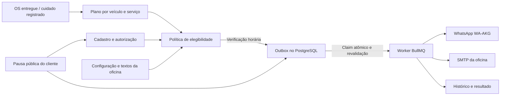

# Central de cuidado com o cliente

Rota: `/relacionamento` → **Cuidado com o cliente** no menu lateral e na busca de páginas.

A oficina mantém presença depois do atendimento: aniversário, retornos de manutenção e inspeções preventivas, com texto personalizado, intervalos por veículo e histórico do resultado de cada envio.

## Começar a usar

1. Configurar e ativar o WhatsApp em `/configuracoes/whatsapp` ou o SMTP em `/configuracoes/email`.
2. Em **Clientes**, registrar a data de nascimento (opcional, pessoa física) e marcar a autorização de lembretes na aba **Preferências**, após confirmar com o cliente. A autorização começa desmarcada e é independente dos avisos da OS.
3. Na central, revisar campanhas, textos, fuso, horários, intervalo entre contatos e orçamento diário. Salvar a ativação da régua. A configuração inicia pausada para permitir preparar os dados.
4. Registrar os últimos serviços conhecidos dos veículos, com a data real e a quilometragem, quando disponível. Não é necessário inventar um histórico para começar.
5. Nos próximos atendimentos, identificar o cuidado no item da OS pelo campo **Programar próximo cuidado ao entregar esta OS**. A entrega atualiza o plano na mesma transação da mudança de status.

Uma entrega gera uma referência para o próximo retorno preventivo. Somente os serviços explicitamente identificados nos itens reiniciam os demais planos: a palavra “óleo” numa descrição não comprova uma troca de óleo. Orçamentos e ordens canceladas não reiniciam os prazos. Uma OS encerrada mantém os vínculos; acertos históricos entram por registro explícito na central.

Para clientes já atendidos e que autorizaram os lembretes, a varredura aproveita a última OS entregue para iniciar o retorno preventivo geral. Não sobrescreve um plano existente nem inventa serviços específicos no histórico antigo.

## Régua inicial

São sugestões editáveis de retorno/avaliação, **não prazos universais de substituição**. O manual do modelo, a especificação da peça, as condições de uso e a inspeção prevalecem. O limite por km só é usado com leitura real registrada; o Ofix não estima quilometragem.

| Cuidado | Intervalo inicial | Antecedência | Intenção da mensagem |
|---|---|---|---|
| 🎂 Aniversário | Uma vez por ano | No dia | Carinho, sem promoção ou desconto inventado |
| 🛡️ Revisão periódica | 6 meses ou 10.000 km | 7 dias | Planejar revisão conforme o veículo |
| 🛢️ Óleo e filtro | 6 meses ou 10.000 km | 7 dias | Conferir prazo e especificação do fabricante |
| 🛑 Pastilhas, discos e freios | Inspeção: 6 meses ou 10.000 km | 7 dias | Medir desgaste; não indicar troca por calendário |
| 💧 Fluido de freio | Conferência: 24 meses | 14 dias | Avaliar condição e plano do manual |
| 🛞 Pneus e geometria | Inspeção: 6 meses ou 10.000 km | 7 dias | Conferir desgaste e necessidade de ajustes |
| 🌬️ Filtro de ar do motor | Inspeção: 12 meses ou 10.000 km | 7 dias | Considerar poeira e uso |
| 🍃 Filtro de cabine | Inspeção: 12 meses ou 15.000 km | 7 dias | Conforto e climatização |
| 🌡️ Arrefecimento | Inspeção: 12 meses ou 20.000 km | 7 dias | Conferir sistema; não presumir troca do fluido |
| 🔋 Bateria e carga | Teste: 12 meses | 7 dias | Testar antes de indicar substituição |
| 🌧️ Palhetas e visibilidade | Inspeção: 12 meses | 7 dias | Conferir limpeza e iluminação |
| ⚙️ Correias | Inspeção: 12 meses ou 20.000 km | 14 dias | Consultar o plano específico do motor |
| ⚡ Ignição e velas | Inspeção: 12 meses ou 20.000 km | 7 dias | Avaliar funcionamento e recomendação do fabricante |

O catálogo e os textos ficam em `packages/contracts/src/customer-care.ts`, compartilhados entre backend e frontend. A oficina pode editar os textos e os intervalos. Um registro manual pode personalizar o intervalo para aquele veículo; campos em branco usam a campanha.

Referências para a abordagem: a [Chevrolet recomenda consultar o manual específico do veículo](https://www.chevrolet.com/support/vehicle/maintenance/schedule/about-ice); a [Bosch descreve a inspeção e os sinais de desgaste dos freios](https://am.boschcarservice.com/br/pt/nossos-servicos/sistema-de-freio/manutencao-dos-freios/); e suas [orientações de manutenção preventiva](https://www.bosch-press.com.br/pressportal/br/pt/press-release-3904.html) tratam de palhetas e preparação dos freios antes de viagens. Os números da tabela são uma configuração inicial do produto para convidar à avaliação, não uma reprodução de um plano de fabricante para todos os carros.

## Política de contato

- Até cinco cuidados próximos são reunidos numa mensagem por cliente, inclusive quando há mais de um carro.
- Por ciclo de serviço: um aviso antecipado, um no prazo e um acompanhamento após 14 dias. A mesma fase não se repete indefinidamente. Registrar um novo serviço inicia um novo ciclo.
- Padrão: intervalo mínimo de 7 dias entre mensagens de manutenção; limite diário de 50 contatos por oficina. Limites editáveis (mínimo de 3 dias, máximo de 500 contatos/dia).
- Aniversário tem prioridade e pode chegar mesmo com manutenção recente, mas respeita no máximo um contato no dia, o horário e o limite diário. Em anos comuns, 29/02 é lembrado em 28/02.
- Horário padrão a partir de 9h no fuso da oficina, até antes de 19h. Preferência manhã/tarde/noite restringe o envio (manhã antes de 12h; tarde de 12h a 17h; noite de 17h a 19h). Manutenções podem ser limitadas aos dias úteis; aniversários permanecem no próprio dia.
- Preferência WhatsApp/e-mail do cliente prevalece sobre o canal padrão. Telefone e SMS não são convertidos silenciosamente para outro canal. Sem destino válido ou canal disponível, não há envio.
- Veículos com OS em atendimento não recebem lembrete de manutenção. Cliente excluído, veículo removido ou transferido, serviço já realizado, campanha pausada e autorização revogada são verificados novamente antes do disparo.
- O link pessoal `/preferencias-de-contato/[token]` não pede login. Abrir o link não muda nada: o cliente confirma a pausa. A pausa desliga aniversário e manutenção e cancela os pendentes; o cadastro conserva o registro do último aceite.
- Pausar/ativar e registrar serviços geram eventos de auditoria sem copiar mensagens, telefones ou datas de nascimento para o log.

O limite diário pode adiar cuidados e deixar de enviar aniversários quando o orçamento se esgotar. Não se envia um parabéns atrasado no dia seguinte. O histórico distingue confirmação do provedor de leitura pelo cliente.

## Arquitetura

- **`CustomerCarePlansService`**: referências reais e reinício dos ciclos. A integração com DELIVERED participa da transação da OS e não chama provedores.
- **`care-policy.ts`**: funções puras para datas, fim de mês, ano bissexto, fuso, janelas, eventos e montagem dos textos. Não depende de Nest, Redis ou rede.
- **`CustomerCareService`**: configurações, dashboard, prévia sem envio e pausa pública. APIs autenticadas usam permissões existentes `alerts.view`, `alerts.manage` e `settings.manage`.
- **`CustomerCareAutomationService`**: varredura paginada, agrupamento, reserva de orçamento, claim, revalidação e adaptadores existentes de canal.
- **PostgreSQL**: plano único por oficina/veículo/serviço; chave de deduplicação por lote; eventos indexados em GIN; bloqueios transacionais por oficina e cliente tornam a reserva de orçamento e a criação do lote seguras com múltiplas réplicas.
- **BullMQ**: fila `customer-care`; varredura a cada hora e despacho a cada minuto. Cada entrega só pode sair de PENDING para SENDING uma vez. Workers reais e agendamentos são desativados em `NODE_ENV=test`.
- **Isolamento**: todos os acessos de background incluem a oficina explicitamente. Os novos modelos também pertencem à extensão de isolamento de tenant. Propriedade atual do veículo é conferida antes de usar o plano.
- **Privacidade**: token público aleatório de 256 bits; lookup pelo SHA-256 e token cifrado na outbox. A consulta pública não revela nome, telefone, nascimento nem histórico. Exportação e exclusão assistida de clientes incluem os novos campos e registros.

### Estados e falhas

`PENDING → SENDING → SENT | UNKNOWN`; verificações podem terminar em `SKIPPED` ou `FAILED`.

`FAILED` significa que a validação do contato/configuração impediu a chamada ao provedor. Após corrigir, a equipe pode recolocar a mensagem na fila; contato, consentimento e prazo são conferidos novamente.

Timeout, resposta inválida ou falha após iniciar a chamada ficam como **UNKNOWN**. Um envio pode ter chegado mesmo sem resposta; por isso não existe retry automático nesse estado. Um SENDING abandonado há cinco minutos também passa para UNKNOWN. Essa escolha evita uma promessa impossível de entrega exatamente uma vez diante de um provedor sem chave de idempotência.

Na retomada, o dispatcher verifica a outbox persistente. Uma falha na gravação do resultado depois do envio não autoriza repetir a mensagem. Registros bloqueados por orçamento/intervalo são reagendados, para não impedir o avanço de outras oficinas.

## Implantação e validação

Aplicar a migration `35_customer_care`, gerar o Prisma Client e publicar backend/frontend juntos. Postgres e Redis são os mesmos da aplicação. A migration não autoriza contatos existentes, não ativa oficinas e não dispara mensagens.

`FRONTEND_URL` precisa apontar para o domínio público correto da aplicação, pois é usado no link pessoal de preferências enviado aos clientes.

Testes relevantes:

- `care-policy.spec.ts`: fuso, ano bissexto, fim de mês, janelas, estágios e km reais.
- `customer-care.e2e-spec.ts`: API real com PostgreSQL, consentimento, concorrência, agrupamento, pausa pública, serviço concluído, canais, limites, isolamento e integração com OS. Provedores externos substituídos por mocks: não envia mensagens reais.
- Testes do frontend e verificação visual em desktop e mobile: editar/salvar campanhas, prévia, registro e histórico.
